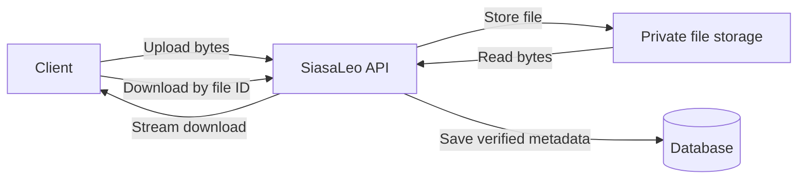

# Digital asset uploads, storage, and downloads

Status: implementation proposal, recorded 2026-10-09. The upload and download
routes below do not exist yet. No production storage provider has been selected.

This guide describes the deferred file-transfer work. See
[Digital assets](digital-assets.md) for implemented ownership, sharing, visibility,
library management and consumer associations. No storage implementation is part
of that domain-management work. This is the single file-transfer proposal;
direct-to-storage uploads may be considered later.

## Existing domain and its limits

The domain separates the identity of source material from its editions and files:

| Record | Responsibility |
| --- | --- |
| `DigitalAsset` | Stable identity, editable description, account/party ownership, visibility and archive state |
| `DigitalAssetVersion` | A particular edition, including provenance, source URL, author, publisher, and sealing timestamp |
| `StoredFile` | Metadata for a representation of that edition: storage key, filename, media type, byte size, and SHA-256 |

A version may reference an external URL, stored files, or both. File
representations are `ORIGINAL`, `PREVIEW`, `THUMBNAIL`, and `TRANSCRIPT`.
Other domains cite a specific sealed version, so adding another edition does
not change the evidence behind existing records.

Currently, `POST /api/digital-assets/versions/{id}/files` accepts JSON metadata.
It does not receive file bytes, confirm that the storage key exists, calculate
the file size, or verify the supplied hash. Format validation of a hash does not
establish that it matches a real file. A file metadata record can therefore
satisfy the sealing requirement without verified bytes being available.

The public `StoredFileDto` omits `storage_key`. It neither provides a download
link nor returns the file contents. Representation labels do not generate
previews, thumbnails, or transcripts.

Sealing freezes database records, not externally hosted content. A source URL
can serve different bytes after sealing. Likewise, a fixed storage key does not
preserve evidence if the object behind that key can be overwritten. A hash can
detect changed bytes when checked; it cannot preserve or recover a file, or
establish the truth of its contents.

## Proposed first implementation

Route uploads and downloads through SiasaLeo. Keep files in private storage and
metadata in the existing database. Stream file contents instead of loading whole
files into application memory.



### Storage component

Introduce a `FileStorage` interface with operations to create a new object,
open an object for reading, and remove an abandoned upload. Isolate provider
details in an implementation of this interface.

A local implementation can use a configured directory for development.
Production storage must survive application redeployments and be accessible to
every application instance. Select and configure that storage before deployment,
including credentials, retention, backup/recovery, and access permissions.

Generate a fresh storage key on the server for every upload. Keep the original
filename as display metadata; never use it as a trusted filesystem path.
Creation must fail if the key already exists. Sealed files must be protected
from overwrite and deletion through storage permissions and the application's
lifecycle rules.

If Amazon S3 is selected, conditional writes can prevent overwriting existing
keys, and bucket policies can require those conditions. This is an option, not
a provider decision; see [S3 conditional writes](https://docs.aws.amazon.com/AmazonS3/latest/userguide/conditional-writes.html).
If preservation instead relies on retained object versions, persist the exact
object version identifier and use it for reads rather than resolving the latest
object at a key.

### Upload endpoint

Proposed route:

```http
POST /api/digital-assets/versions/{versionId}/uploads
Content-Type: multipart/form-data
```

The client supplies the file and `representation_type`. The server generates the
storage key and calculates `byte_size` and `sha256` from the received bytes.
The declared media type and filename are input to validate, not proof of format.

1. Authenticate the caller and require asset management authority and an unsealed
   version before accepting the transfer.
2. Enforce configured size and supported format limits while receiving the file.
   Configure compatible limits at the application server and any reverse proxy.
3. Stream the contents while counting bytes and calculating SHA-256. Complete
   file validation before making the upload available for use.
4. Finish storing the object under its generated key.
5. In a short database transaction, recheck management authority and the unsealed state,
   then insert `StoredFile` with verified metadata.
6. Return the existing public file metadata shape, including the file ID and
   excluding the storage key.

The current JSON file-registration endpoint must be retired for ordinary clients
or restricted to a trusted internal workflow. Otherwise clients could bypass
verification by supplying arbitrary keys, sizes, and hashes.

The project targets Jakarta EE 11. Jakarta REST provides multipart input and
streamed output APIs; verify behavior on the actual Payara deployment. See the
[Jakarta REST specification](https://jakarta.ee/specifications/restful-ws/4.0/jakarta-restful-ws-spec-4.0.html).

### Storage/database failures and concurrent sealing

Object storage and the database do not share a transaction. Avoid holding a
database transaction open throughout a potentially long file transfer.

If transfer or validation fails, remove partial data. If storage succeeds but
registration fails, remove the abandoned object. Cleanup failures and process
crashes need a retryable reconciliation mechanism; request-level exception
handling alone cannot cover them.

Track upload attempts or staging objects sufficiently to distinguish abandoned
objects from active transfers and registered files. Cleanup must check durable
registration state and must not remove referenced files. In particular, a lost
HTTP response after a successful database commit is not a reason to delete the
object.

Recheck state when registering because another request may seal the version
during transfer. Existing database child guards serialize file attachment
changes with sealing; preserve those guards. If sealing wins, reject final
registration and clean up the unattached object. Seal only completed, verified
file records. A staging/upload-attempt record must not count as evidence.

### Download endpoints

Proposed routes, following the existing metadata read conventions:

| Route | Proposed access |
| --- | --- |
| `GET /api/digital-assets/files/{fileId}/content` | Sealed PUBLIC files for anonymous readers; explicit asset grants for private access |
| `GET /api/digital-assets/me/files/{fileId}/content` | Authenticated access; owner/manager for drafts and READ grants for sealed files |

Downloads must reuse the implemented asset policy: sealing alone never makes
a file public. New assets default to PRIVATE. Confirm the content-download
contract before exposing these proposed routes.

Resolve the file ID to its version and asset, enforce access, and then open the
stored object. Stream the bytes with the validated content type, actual content
length, and a safely encoded `Content-Disposition` attachment filename. Keep
draft responses private and prevent shared caching of them. Do not expose storage
keys or accept client-supplied storage paths as download targets.

Define responses for missing file records, unauthorized access, missing stored
objects, and storage outages. Missing bytes behind a valid record are an
operational integrity problem and must be observable.

### Existing records and source URLs

Inventory metadata-only `StoredFile` records before relying on the new workflow.
Locate each object, calculate its actual size and hash, and identify missing or
mismatched objects. Do not label historical records verified merely because the
new upload endpoint exists.

Sealed versions and their file records are immutable under existing database
rules. Do not silently rewrite them during reconciliation. Resolve discrepancies
through new versions or an explicitly designed migration. If verification state
must be tracked separately, design that persistence and its sealing/download
rules before implementation.

URL-only versions remain valid under current rules. Document that they preserve
a reference, not a captured copy. Capturing external URLs is a separate feature;
users can initially upload a retrieved copy as an original file and record its
origin in the version's provenance.

## Implementation locations

Paths are relative to the repository root.

| Location | Planned work |
| --- | --- |
| `src/main/java/com/arriyiaconsulting/siasaleo/service/domain/digitalasset/boundary/DigitalAssetResource.java` | Add multipart upload and binary download routes; resolve the old registration route |
| `src/main/java/com/arriyiaconsulting/siasaleo/service/domain/digitalasset/control/DigitalAssetService.java` | Preserve ownership/sealing rules and register only completed, verified uploads |
| New storage and transfer components | Stream bytes, calculate metadata, access storage, and coordinate cleanup |
| `src/main/java/com/arriyiaconsulting/siasaleo/service/domain/digitalasset/repository/StoredFileRepository.java` | Resolve registered files for downloads and reconciliation |
| `src/main/resources/database/migrations/` | Add migrations if durable upload tracking, verification state, or object version identifiers require schema changes |
| Deployment configuration | Configure storage, credentials, size limits, cleanup, and retention |
| `docs/governance-api.md` | Publish implemented request/response contracts and access rules |

## Acceptance checks

- Upload an original file, seal its version, and download identical bytes.
- Verify the stored byte count and SHA-256 against the actual uploaded contents.
- Reject oversized or unsupported files and leave no usable partial records.
- Reject uploads by another account and uploads to sealed versions.
- Keep draft downloads restricted to owners/managers, including cache behavior.
- Verify public sealed downloads under the agreed policy without exposing keys.
- Prevent the old registration route from bypassing verification.
- Exercise storage failures, registration failures, cleanup retries, crashes,
  and lost responses without deleting successfully registered objects.
- Test upload-versus-seal races against PostgreSQL with separate connections.
- Verify overwrite prevention and cleanup protection for sealed files in the
  selected storage implementation.
- Test multipart upload and streaming download over HTTP on the deployed runtime.

## Decisions and delivery order

Before implementation, select production storage, initial supported formats and
size limits, the file validation policy, public download policy, and the handling
of existing unverified records. Define storage retention and recovery needs.

Deliver one complete path first: upload an original file, register verified
metadata, seal the version, and download the same bytes. Include failure cleanup
and the acceptance checks in that delivery.

Automatic previews, thumbnails, transcripts, external URL capture, and direct
client-to-storage transfers can follow as separate features. Any generated
representations attached to a version must be registered before sealing under
the current immutability rules.
