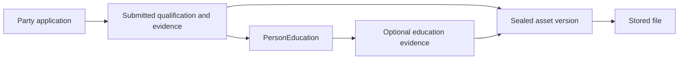

# Education evidence and political party applications

Status: architecture proposal and implementation plan, recorded 2026-10-12.
The associations and application workflows proposed here are not implemented.

## Purpose

Keep education records reusable and document uploads optional. Make documentary
proof a requirement of a political party's application workflow, rather than a
universal prerequisite for recording education or expressing interest in a contest.

This document records the proposed architecture and phased work plan. Related
documentation:

- [Education API](education-api.md)
- [Candidate registration API](candidate-registration-api.md)
- [Digital assets](digital-assets.md)
- [File upload and download proposal](digital-asset-file-storage.md)

## Existing foundation

`PersonEducation` records a person's education independently of a candidacy.
`EducationService` currently permits those records to be edited and deleted.
`Candidacy` represents a person's entry into a contest, with an optional political
party affiliation.

`digitalasset` manages asset identities, versions, file metadata, ownership, and
permissions. Its current file endpoint registers metadata rather than transferring
or verifying file bytes. Existing grants are account-based and asset-wide; they do
not express access to a particular submitted version through an application.

## Domain ownership

| Domain | Responsibility |
| --- | --- |
| `education` | Qualifications and the association between a qualification and supporting evidence |
| `digitalasset` | Document identity, sealed versions, file metadata, storage integration, and media access |
| `candidate` / nomination management | Party requirements, applications, submissions, reviews, and decisions |
| `party` | Shared person and organization concepts |

Initially place application requirements, submissions, and reviews in `candidate`,
using dedicated services. Consider a separate nomination domain if the workflow
grows enough to warrant it. A political party's review process does not belong in
the shared `party` domain merely because the applicant is a person.

## Optional education evidence

Introduce an education-owned association:

```text
PersonEducationEvidence
  id
  personEducationId
  assetVersionId
  documentKind          // certificate, transcript, equivalency letter
  attachedByAccountId
  attachedAt
```

An education record can have zero or more supporting documents. Each association
references a sealed asset version. Attaching evidence requires permission to manage
the qualification and use the selected document.

Use this explicit association instead of also creating a `PersonDigitalAsset`
association for the same purpose. A generic person attachment does not identify
which qualification a document supports.

Recording a qualification remains possible without evidence. The education domain
does not decide which political party requires a certificate or transcript.

## Application requirements

Model the application dossier separately from the existing contest candidacy:

```text
PartyApplication
  personId
  politicalPartyId
  contestId
  candidacyId           // where linked to an existing candidacy
  requirementRevisionId
  status

ApplicationRequirement
  politicalPartyId
  intake/contest scope
  requirement kind
  required document kinds
```

These are conceptual fields, not a finalized database schema. Requirements should
be grouped into published revisions. Bind each application to an explicit revision
so policy changes do not silently change its obligations.

Different parties can require different evidence at different stages:

| Operation | Evidence rule |
| --- | --- |
| Save education profile | Documents optional |
| Save application draft | Incomplete evidence allowed |
| Submit application | Enforce the applicable party requirements |
| Advance through review | Enforce any requirements assigned to that transition |

The exact lifecycle, relationship to candidacy, and transition rules must be agreed
before implementation.

## Reuse files and preserve submissions

An aspirant selects existing qualifications and supporting documents when preparing
an application. Both the education association and the application submission can
reference the same sealed asset version and stored file.



These associations express distinct facts:

- Education evidence: this document supports this qualification.
- Application submission: this document was submitted to this party for this application.

No second upload or file copy is required.

At submission, capture an immutable revision containing:

- Qualification details as submitted.
- Exact sealed asset version IDs.
- The applicable requirement revision.
- Submitter and submission time.

Keep the source education ID for traceability, but preserve the submitted details
independently of later profile changes. A small historical snapshot is intentional;
it is not another editable education profile. Versioning education records is an
alternative if broader requirements justify that additional machinery.

Corrections create amendments or submission revisions. Editing a profile or removing
an education evidence link must not silently alter a prior submission. Define
deletion and retention rules for referenced records and file bytes accordingly.

## Scoped review and access

Store review outcomes, reasons, reviewers, timestamps, and the reviewed submission
revision with the application. A party's acceptance is contextual: it must not
automatically set a global `verified` flag on the person's qualification.

Keep documents private by default and owned by the uploader. Submission authorizes
the appropriate application reviewers to access the submitted versions; it does not
transfer ownership or expose the applicant's whole document library.

Add application-aware access checks for both metadata and file delivery. Existing
asset-wide grants alone are too broad for a rule such as "reviewers of application X
may read submitted version Y." Reviewers must not gain access to future versions
merely because they could read a submitted version.

Document access after withdrawal, closure, reviewer reassignment, or evidence
replacement must follow explicitly agreed lifecycle and retention rules.

## Implementation plan

### Phase 1: Agree workflow and boundaries

- Define application creation and its relationship to `Candidacy`.
- Define requirement scope by party, contest, and application round.
- Decide when evidence becomes mandatory.
- Define submitter, reviewer, correction, and decision permissions.
- Define access and retention after withdrawal or closure.
- Keep the initial workflow in `candidate` with dedicated services.

Deliverable: lifecycle, domain ownership model, and permission matrix.

### Phase 2: Implement private document upload and retrieval

Build on the existing [file-transfer proposal](digital-asset-file-storage.md), which
remains the source for storage implementation details. Its initial approach routes
uploads and downloads through SiasaLeo; direct-to-storage transfers are not required
by this plan.

- Implement authenticated upload handling and completion.
- Verify file existence, size, checksum, and allowed format before sealing.
- Add scanning and availability states appropriate for uploaded documents.
- Implement authorized file delivery; any later download links must be short-lived
  and issued only after authorization.
- Handle incomplete uploads and orphaned files.
- Preserve private ownership and prevent replacement of sealed file bytes.

Deliverable: a user can upload, seal, and retrieve a private document through a
working storage integration.

### Phase 3: Add optional education evidence

- Add the `PersonEducationEvidence` migration, entity, repository, DTOs, and service.
- Add endpoints to list, attach, and remove evidence.
- Validate qualification ownership and permission to attach a sealed version.
- Keep evidence optional for education creation and editing.
- Avoid a redundant generic person attachment for the same educational purpose.

Deliverable: qualifications reference certificates and transcripts without
duplicating stored files.

### Phase 4: Add applications and versioned requirements

- Add application records linked to person, political party, contest, and candidacy
  where applicable.
- Add requirement sets and stable published revisions.
- Add party administration of requirements.
- Add application draft creation and editing.
- Allow selection of existing qualifications and evidence.
- Add a completeness check that explains missing requirements.
- Bind applications to explicit requirement revisions.

Deliverable: an aspirant can prepare a party application using existing profile
information and documents.

### Phase 5: Implement immutable submissions

- Validate requirements at submission.
- Capture qualification snapshots, sealed version references, requirement revision,
  submitter, and submission time.
- Preserve traceability to source education records.
- Protect submitted evidence from profile edits and destructive deletion.
- Create new submission revisions for corrections.

Deliverable: a stable record of what the aspirant submitted and what requirements
applied at that time.

### Phase 6: Add application-scoped access and review

- Authorize assigned reviewers for the specific submitted document versions.
- Apply the same checks to metadata and actual downloads.
- Prevent access to unrelated applications, unsubmitted evidence, and newer versions.
- Record review outcomes, reasons, reviewers, timestamps, and submission revisions.
- Support correction requests and agreed application decisions.
- Keep party acceptance separate from platform-wide credential verification.

Deliverable: authorized party staff can assess applications without accessing
unrelated private documents.

### Phase 7: Build the user flows

- Add optional document attachment to the education page.
- Show an application checklist based on party requirements.
- Allow selection of previously uploaded evidence.
- Show exactly what will be shared before submission.
- Provide a reviewer workspace for evidence, findings, and decisions.
- Support correction and resubmission.
- Reuse upload and document-selection components across screens.

Deliverable: a complete aspirant-to-reviewer workflow.

### Phase 8: Validate and roll out

Cover the following behavior with integration and authorization tests:

- Education remains usable without document uploads.
- One document supports multiple applications without copying its bytes.
- Cross-party and unassigned-reviewer access is rejected.
- Reviewers cannot access unsubmitted or newer document versions.
- Profile edits and evidence removal preserve prior submissions.
- Requirement changes do not alter submitted obligations.
- Failed uploads and concurrent submissions are handled safely.

Pilot with one political party and a small requirement set before broader release.

Deliverable: a validated pilot with the agreed access and lifecycle behavior.

## Delivery milestones

| Milestone | Phases | Outcome |
| --- | --- | --- |
| Document foundation | 1-3 | Optional, reusable education evidence |
| Application preparation | 4-5 | Requirements and stable submissions |
| Party review pilot | 6-8 | Secure, complete application management |

Start with private file transfer and optional education evidence. This establishes
the reusable foundation before introducing party-specific workflow complexity.
